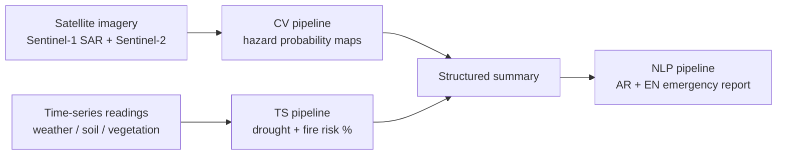

# PARADOX — Multi-Hazard Early Warning: Time-Series Module (Demo)

> نموذج تجريبي (demo) لتوقع **خطر الجفاف** و**خطر الحريق** بعد 7 أيام في مناطق من مصر، باستخدام بيانات الطقس اليومية ونموذج **LSTM**.
> A proof-of-concept that forecasts **drought risk** and **fire risk** 7 days ahead for Egyptian regions from daily weather data, using an **LSTM**.

⚠️ **Demo only / للعرض التجريبي فقط.** ليس نظام إنذار تشغيلي ولا يصلح لاتخاذ قرارات حقيقية. Not an operational warning system.

---

## Table of contents

1. [Overview / نظرة عامة](#1-overview--نظرة-عامة)
2. [What the demo does / الديمو بيعمل إيه](#2-what-the-demo-does--الديمو-بيعمل-إيه)
3. [Repository structure / هيكل الريبو](#3-repository-structure--هيكل-الريبو)
4. [Quick start / تشغيل سريع](#4-quick-start--تشغيل-سريع)
5. [Data / البيانات](#5-data--البيانات)
6. [Method / المنهجية](#6-method--المنهجية)
7. [Experiments & results / التجارب والنتائج](#7-experiments--results--التجارب-والنتائج)
8. [Key findings & honest notes / ملاحظات وخلاصات صريحة](#8-key-findings--honest-notes--ملاحظات-وخلاصات-صريحة)
9. [Limitations / القيود](#9-limitations--القيود)
10. [Future work / الخطوات الجاية](#10-future-work--الخطوات-الجاية)
11. [Reproducibility / إعادة التشغيل](#11-reproducibility--إعادة-التشغيل)
12. [Data attribution & disclaimer](#12-data-attribution--disclaimer)

---

## 1. Overview / نظرة عامة

المشروع الأكبر (Multi-Hazard Early Warning) مقسّم لـ 3 pipelines:



**هذا الريبو يغطي الـ TS pipeline فقط (this repo = the TS module only).**
الـ CV والـ NLP خارج نطاق الريبو ده.

- الزلازل **مش داخلة** في الـ TS: مالهاش سلوك تراكمي زي الجفاف والحريق.
- الهدف هنا: **ديمو شغال** بيثبت الفكرة، مش نظام كامل.

---

## 2. What the demo does / الديمو بيعمل إيه

واجهة **Gradio**: تختار المنطقة والتاريخ، فتشوف:

- منحنى آخر 60 يوم لخطر الجفاف والحريق.
- نسبة الخطر (%) لأول 7 أيام جاية + مستوى الخطر (منخفض / متوسط / مرتفع) بالعربي والإنجليزي.


| Case | Expectation / المتوقع |
|---|---|
| Delta, 2025-03-15 | High drought (2025 rainy season was the driest in the data) |
| Alexandria, 2020-02-15 | Low drought (wet season) |
| Fayoum, 2025-07-15 | High fire (proxy), no drought (summer) |

مستويات الخطر المعروضة (أقل من 33% منخفض، 33–66% متوسط، أكتر من 66% مرتفع) **حدود عرض اختيارية** ومش معايرة على بيانات حقيقية.

---

## 3. Repository structure / هيكل الريبو

```
paradox-ts-early-warning/
├── README.md
├── requirements.txt
├── .gitignore
├── notebooks/
│   └── ts_demo.ipynb              # الـ pipeline كامل (سحب الداتا → تدريب → واجهة)
├── model/
│   └── lstm_multihazard.keras     # الموديل المدرّب (مخرجين: drought, fire)
├── config.json                    # features, splits, labels, scaler, thresholds
├── metrics.json                   # مقاييس الـ test للموديل النهائي
├── results_summary.md             # ملخص أرقام جاهز
├── data/
│   ├── <region>_features.csv      # الـ features + الـ labels لكل منطقة
│   └── <region>_predictions.csv   # توقعات الموديل لكل يوم
└── figures/
    ├── demo_ui.png
    ├── delta_2025-03-15.png
    ├── alex_2020-02-15.png
    └── fayoum_2025-07-15.png
```

الـ **notebook هو المصدر الأساسي** للكود؛ باقي الملفات مخرجاته.

---

## 4. Quick start / تشغيل سريع

**Google Colab (الأسهل):** افتح `notebooks/ts_demo.ipynb` وشغّل الخلايا بالترتيب. سحب الداتا محتاج إنترنت (NASA POWER API) ومش محتاج مفتاح.

**محليًا:**

```bash
git clone <repo-url>
cd paradox-ts-early-warning
python -m venv .venv && source .venv/bin/activate   # Windows: .venv\Scripts\activate
pip install -r requirements.txt
jupyter notebook notebooks/ts_demo.ipynb
```

> ملحوظة: الـ `requirements.txt` غير مثبّت الإصدارات. لو عايز نفس بيئة التدريب بالظبط، استخدم النسخة المثبّتة اللي بتتولّد مع الـ notebook.

---

## 5. Data / البيانات

**المصدر:** [NASA POWER](https://power.larc.nasa.gov/) — daily point API، community `AG`، من **2015-01-01** لحد **2026-09-20** (4,281 يوم لكل موقع). مجاني وبدون API key.

| Region | Lat | Lon |
|---|---|---|
| Fayoum | 29.31 | 30.84 |
| Delta | 30.79 | 31.00 |
| Alexandria | 31.20 | 29.92 |
| Marsa Matrouh | 31.35 | 27.24 |
| El-Arish | 31.13 | 33.80 |
| Minya | 28.11 | 30.75 |

**المتغيرات المسحوبة:** `T2M`, `T2M_MAX` (الحرارة)، `PRECTOTCORR` (الأمطار)، `RH2M` (رطوبة الهوا)، `WS2M` (الرياح)، `GWETTOP` و`GWETROOT` (رطوبة التربة).

**ملاحظات على الداتا:**
- القيمة `-999` = قيمة ناقصة عند NASA، بتتحول لـ `NaN`.
- `GWETROOT` **مستبعد**: تباينه قليل جدًا (الانحراف المعياري ≈ 0.03) فمش بيفيد كإشارة.
- رطوبة التربة هنا **مخرجات موديل reanalysis مش قياس حقلي** (in-situ). كافي للديمو، مش بديل لقياس حقيقي.
- أقصى يوم مطر في الفيوم (~125mm في 2016-11-30) بيبان مبالغ فيه لمنطقة صحراوية، لكنه جزء من عاصفة حقيقية على يومين. **اتساب** وطُبّق عليه `log1p`.
- الـ 7 أيام الأخيرة بتتشال لأن مفيش target ليهم، فأحدث تاريخ متاح في الديمو تقريبًا منتصف سبتمبر 2026.
- **مطروح:** رطوبة التربة ثابتة تقريبًا عند ~0.75 في كل السنين، وده غير منطقي لمنطقة قاحلة (غالبًا الـ grid cell قريبة من البحر). أداؤها أضعف (F1 ≈ 0.74). **استُبعدت من قايمة الديمو بس، لكنها لسه جزء من التدريب.**

---

## 6. Method / المنهجية

### 6.1 Features (14)

| Group | Features |
|---|---|
| Raw | `T2M`, `T2M_MAX`, `RH2M`, `WS2M`, `GWETTOP` |
| Rain | `rain_log` = log1p(rain)، `rain_30d` = مجموع آخر 30 يوم |
| Soil | `soil_anom` (انحراف عن المعتاد لنفس الشهر)، `soil_d7` = تغيّر آخر 7 أيام |
| Temperature | `T2M_7d` = متوسط 7 أيام |
| Season | `doy_sin`, `doy_cos` |
| Fire proxy | `dsr` (أيام من غير مطر)، `fdi` (مؤشر طقس الحريق) |

### 6.2 Drought label

الجفاف **مش threshold ثابت**: رطوبة التربة السطحية تنزل من ~0.30 شتاءً لـ ~0.09 صيفًا، فأي threshold ثابت هيعلّم كل صيف كجفاف والموديل هيتعلم "الصيف = جفاف".

1. `soil_anom` = (GWETTOP − متوسط الشهر) / الانحراف المعياري للشهر، محسوب **من سنين التدريب بس** ولكل موقع لوحده، ومقصوص عند ±3.
2. متوسط 14 يوم للـ anomaly (يوم واحد جاف مش جفاف).
3. **جفاف = المتوسط < −1، وفي موسم المطر فقط (أكتوبر–أبريل).** في الصيف الانحراف المعياري صغير جدًا (~0.02) فالـ z-score يضخّم أي مطرة صغيرة.
4. الـ target = الحالة **بعد 7 أيام**.

### 6.3 Fire label (proxy) ⚠️

**مفيش سجلات حرائق حقيقية في الديمو.** الـ label مبني من مؤشر طقس بسيط:

```
fdi = 0.35 · norm(T2M_MAX) + 0.35 · (1 − norm(RH2M)) + 0.15 · norm(WS2M) + 0.15 · (days_since_rain / 60)
```

- `norm` = min-max بين الـ 5th و95th percentile من سنين التدريب.
- `days_since_rain` = أيام من آخر يوم مطر أكتر من 1mm (سقف 60).
- **حريق = fdi بعد 7 أيام أعلى من الـ 85th percentile لسنين التدريب.**

⚠️ الـ label دالة في نفس الـ inputs، فالموديل بيتنبأ بمؤشر الطقس بعد أسبوع، **مش باحتمال حريق فعلي**. الرقم بيقول "الظروف خطرة"، مش "هيحصل حريق".

### 6.4 Splits (time-based, no shuffling)

| Split | Period | Note |
|---|---|---|
| Train | 2015 → 2022-12 | |
| Val | 2023-01 → 2024-12 | early stopping |
| Test | 2025-01 → end | |

بين كل split وتاله **فجوة 7 أيام** عشان الـ target مايتسربش. والـ scaling بإحصائيات الـ train بس.

### 6.5 Model

```
Input (30 days × 14 features)
  → LSTM(32) → Dropout(0.3) → Dense(16, ReLU) → Dense(2, sigmoid)   # [drought, fire]
```

Adam (lr=1e-3)، binary cross-entropy، batch 128، حد أقصى 30 epoch، EarlyStopping (patience 5) على val loss، seed = 1. بدون class weights.

---

## 7. Experiments & results / التجارب والنتائج

### 7.1 Metrics of the final demo model

الأرقام النهائية (LSTM بمخرجين) في `metrics.json` و`results_summary.md`:

| Head | PR-AUC (test) | F1 (test) | Base rate |
|---|---|---|---|
| Drought | _TBD_ | _TBD_ | _TBD_ |
| Fire (proxy) | _TBD_ | _TBD_ | _TBD_ |

### 7.2 Exploration experiments (drought only)

مرحلة الاستكشاف كانت على الجفاف بـ LSTM بمخرج واحد و12 feature. التقييم على **صفوف موسم المطر بس**، والـ threshold مختار من الـ val. الـ persistence = "بعد أسبوع هيفضل زي النهارده".

| Model | F1 val | F1 test | PR-AUC test | Onset recall (val / test) | Recovery correct (val / test) |
|---|---|---|---|---|---|
| Persistence | 0.76 | 0.90 | n/a | 0.00 / 0.00 | 0.00 / 0.00 |
| Logistic regression | 0.84 | 0.92 | 0.976 | 0.53 / 0.52 | 0.67 / 0.58 |
| LSTM | 0.83 | 0.91 | 0.969 | 0.67 / 0.45 | 0.59 / 0.50 |

- **Onset** = بداية الجفاف، **Recovery** = نهايته. الـ persistence بالتعريف مبيقدرش يلقطهم.
- الـ persistence حقق دقة (accuracy) 95.4% بس، لأن معظم الأيام أصفار، فـ accuracy مقياس مضلل هنا.

### 7.3 Ablation: بدون إشارة رطوبة التربة (ومن غير مطروح)

بنشيل `GWETTOP` و`soil_anom` و`soil_d7` ونخلي الموديل يتنبأ من المسببات بس (مطر، حرارة، رطوبة هوا). الـ logistic regression بياخد آخر يوم + متوسط النافذة.

| Model | F1 val | F1 test | PR-AUC test | Onset recall (val / test) | Recovery correct (val / test) |
|---|---|---|---|---|---|
| Logistic regression | 0.51 | 0.81 | 0.906 | 0.59 / 0.60 | 0.42 / 0.45 |
| LSTM | 0.66 | 0.63 | 0.847 | 0.65 / 0.51 | 0.65 / 0.70 |

### 7.4 Event counts

الجفاف بيستمر أسابيع، فعدد **الحلقات المستقلة** أقل بكتير من عدد الصفوف:

| Split | Independent drought episodes (6 regions) |
|---|---|
| Train | 61 |
| Val | 20 |
| Test | 20 (≈ شتاءين بس) |

---

## 8. Key findings & honest notes / ملاحظات وخلاصات صريحة

1. **الـ LSTM مكسبش على logistic regression بسيط.** الفروق داخل الـ noise (حوالي 20 حلقة في الـ test)، وفي الـ ablation الـ logreg كسب بوضوح على الـ test. الـ features المهندسة (`rain_30d`, `T2M_7d`) بتلخّص التاريخ أصلًا، فالـ LSTM مالوش إشارة إضافية، والداتا صغيرة على موديل تسلسلي. **الـ LSTM محتفظ بيه في الديمو عشان يطابق تصميم الـ pipeline، مش لأنه أحسن.**
2. **الـ label نصه معروف من الـ inputs.** الـ label = متوسط 14 يوم ينتهي بعد 7 أيام من دلوقتي، فـ 7 أيام منهم موجودة أصلًا في نافذة المدخلات. عشان كده الأرقام العالية (F1 ≈ 0.9) **مش إنجاز حقيقي**، والمقياس الأصدق هو الـ **onset/recovery**.
3. **الـ onset recall حوالي 0.5** لكل الموديلات: نص بدايات الجفاف بتفوت. دي أضعف نقطة في المشروع.
4. **الـ test مختلف جدًا عن التدريب (distribution shift).** نسبة الجفاف في موسم المطر: ~9% (train)، ~19% (val)، ~53% (test). موسم 2025 جاف فعلًا في الداتا (الدلتا 12mm، الإسكندرية 29mm، المنيا 6mm مقابل متوسطات أعلى بكتير)، فالـ test اختبار قاسي بس بيعتمد على سنة شاذة واحدة.
5. **الـ threshold مش بينتقل بين val وtest** بسبب الـ shift. عشان كده بنعتمد على **PR-AUC** (مش بيعتمد على threshold) بجانب F1.
6. **الـ persistence baseline ضروري:** الجفاف بيتغير ببطء، فأي موديل لازم يتقارن بيه، وإلا الأرقام العالية مضللة.
7. **رطوبة التربة هي أهم إشارة.** من غيرها الأداء بينزل بوضوح. في التطبيق الحقيقي لازم مصدر رطوبة تربة فعلي (مثلًا SMAP)، مش reanalysis.
8. **مشكلة الـ label في الصيف اتكشفت بالفحص:** أول محاولة بـ threshold على الـ anomaly طول السنة طلّعت صفر جفاف في يوليو–أكتوبر و`max z = 9.14` كله في يونيو 2025 (أثر الانحراف المعياري الصغير). الحل كان قصّ ±3 وتقييد الجفاف بموسم المطر.
9. **الحريق proxy بالكامل** (القسم 6.3). أي رقم حريق في الديمو بيعبّر عن ظروف الطقس، مش عن حرائق حصلت.

---

## 9. Limitations / القيود

- **الحريق بدون ground truth** (proxy فقط).
- **منطقة واحدة صغيرة لكل موقع:** نقطة واحدة لكل منطقة (grid cell)، مش تغطية مكانية.
- **6 مواقع و~12 موسم:** عدد أحداث محدود، ونتايج الـ test بتعتمد على شتاءين.
- **المواقع مش مستقلة:** نفس المنخفض الجوي بيأثر على مواقع قريبة، فالأحداث الفعلية المستقلة أقل من المعدود.
- **رطوبة التربة من reanalysis** وفيها مشكلة معروفة في مطروح.
- **الاحتمالات غير معايرة (uncalibrated)** ومستويات الخطر (33/66) اعتباطية.
- **مفيش تكامل** مع الـ CV والـ NLP لسه.
- **مفيش اختبار على بيانات أحداث فعلية موثقة** (مثلًا تقارير جفاف رسمية).

---

## 10. Future work / الخطوات الجاية

- [ ] استبدال الـ fire proxy بكشوفات حرائق حقيقية من **NASA FIRMS** (VIIRS). ملحوظة: الـ area API عمليًا بيقبل **1–5 أيام لكل طلب** (الصفحة بتقول 10)، وأحسن تسحب مربع واحد يغطي المواقع وتوزّعها بعدين. ولازم تستبعد المشاعل الثابتة (gas flares) والحرق الزراعي لو مش هو الهدف.
- [ ] **FastAPI endpoint** بيرجّع JSON (المنطقة، التاريخ، نسبة الجفاف والحريق) عشان الـ NLP pipeline ياخده مباشرة.
- [ ] إضافة **NDVI** من MODIS كـ feature.
- [ ] مصدر رطوبة تربة فعلي (SMAP) وإعادة الـ ablation.
- [ ] معايرة الاحتمالات (calibration) وتحديد مستويات الخطر بشكل مدروس.
- [ ] مواقع أكتر + cross-validation بالزمن (rolling-origin) بدل split واحد.
- [ ] تقييم على **أحداث جفاف موثقة** من مصادر رسمية.
- [ ] تحسين الـ onset recall (مثلًا loss يركّز على التحولات، أو target مختلف).

---

## 11. Reproducibility / إعادة التشغيل

- **Seed** = 1 لـ Keras. النتايج ممكن تتغير بين الأجهزة والإصدارات بفروق صغيرة.
- كل إعدادات الـ pipeline (features، splits، تعريف الـ labels، الـ scaler، حدود مؤشر الحريق، الـ climatology) محفوظة في `config.json`.
- الداتا بتتسحب من NASA POWER وقيمها ممكن تتحدّث (reprocessing)، فنسخ `data/` هي **snapshot** وقت التدريب.
- الـ target لأول وآخر أيام كل موقع بيتشال (نافذة 30 يوم + horizon 7 أيام).

---

## 12. Data attribution & disclaimer

- Data: **NASA Langley Research Center POWER Project** (https://power.larc.nasa.gov/). لازم تذكر المصدر في أي استخدام.
- المشروع بحثي/تعليمي ولا يقدّم أي ضمان. **لا تستخدمه لاتخاذ قرارات طوارئ أو سلامة.**
- Research/educational demo — no warranty. Do not use for emergency or safety decisions.
